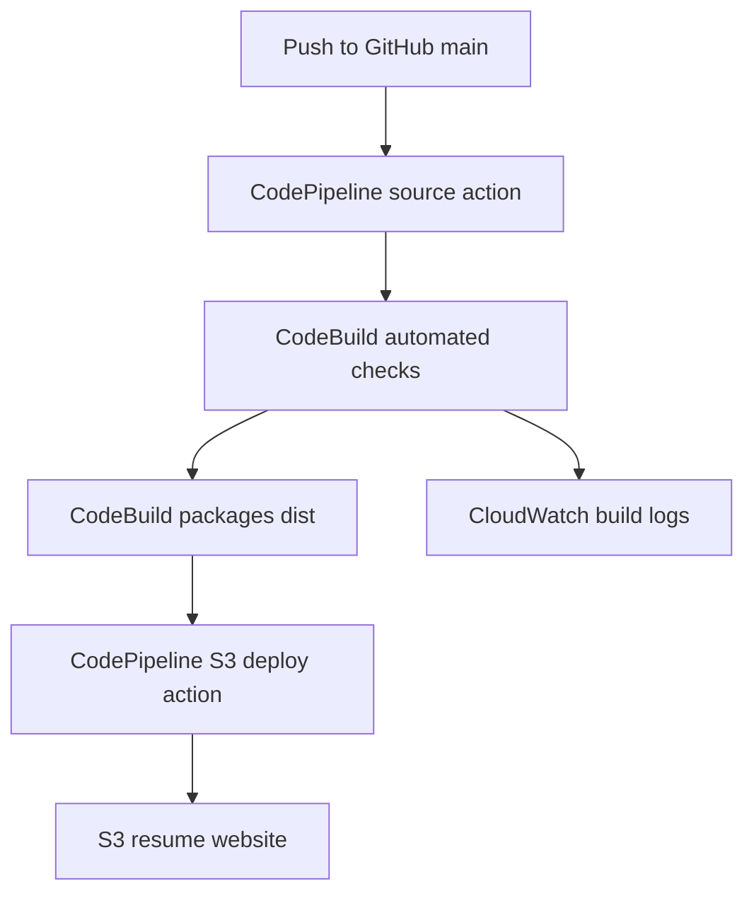

# Calvin Nguyen Resume Website

COMP 4964 individual continuous delivery assignment. A responsive resume website with a GitHub → AWS CodePipeline → CodeBuild → S3 deployment workflow.

## Current status

The website, build script, automated checks, and documentation are prepared. Local checks have passed. AWS resources, GitHub connection, automatic triggering, and live deployment must still be configured and verified. Update this status after completing the cloud setup.

## Architecture



CodePipeline coordinates three stages: Source, Build and Test, and Deploy. Automated checks run in CodeBuild's pre_build phase; a failing check aborts the build. The build copies the website into a clean `dist/` directory. CodeBuild uploads that directory as the build output artifact. The S3 deploy action extracts this artifact into the hosting bucket. CodePipeline's private artifact bucket is separate from the public website bucket.

The initial architecture uses an S3 static website endpoint, which supports HTTP. CloudFront and HTTPS can be added later, but are not included in this setup. There is no application server, database, or custom domain requirement.

## Project files

```text
site/
  index.html
  styles.css
  assets/Calvin-Nguyen-Resume.pdf
scripts/build.py
tests/test_site.py
buildspec.yml
.gitignore
README.md
```

Only the contents of `site/` are deployed. Documentation, tests, and build configuration stay in GitHub. Python 3.9 or newer is required. The project uses only the Python standard library and has no package installation step.

## 1. Preview locally

Extract the project and open `site/index.html` in your browser. No server is required for the resume page. Alternatively, from the project root:

```bash
python3 -m http.server 8000 --directory site
```

Open http://localhost:8000. On Windows, use `py` instead of `python3` if that is your installed Python launcher.

Run the checks and build:

```bash
python3 -m unittest discover -s tests -v
python3 scripts/build.py
```

The seven automated checks cover required resume sections, internal navigation, local asset availability, unique IDs and the main heading, the mobile viewport declaration, the PDF download, and exact build output contents. These are structural checks, not a browser rendering test or a full accessibility audit.

## 2. Create the GitHub repository

Create an empty GitHub repository named `COMP4964-Resume-Pipeline`. Do not initialize it with a README or .gitignore, because both are already included. From the extracted project folder:

```bash
git init -b main
git add .
git commit -m "Add resume website and AWS pipeline configuration"
git remote add origin https://github.com/cnguyen50/COMP4964-Resume-Pipeline.git
git push -u origin main
```

If you choose a different repository name, use its actual remote URL. Verify that `site`, `scripts`, `tests`, `README.md`, `buildspec.yml`, and `.gitignore` are present on GitHub. The generated `dist/` folder should not be committed.

## 3. Create the S3 website bucket

Use one AWS Region consistently for the pipeline, build project, and website bucket. Create a general-purpose bucket with a globally unique name. Keep ACLs disabled using Bucket owner enforced.

In bucket Properties, enable Static website hosting, choose Host a static website, and set the index document to `index.html`. An error document is not required for this single-page site.

For this hosting approach, the website files need public read access. In Permissions, adjust Block Public Access for this website bucket to allow a public bucket policy. Account-level or organization restrictions may also block public access. Keep the separate pipeline artifact bucket private. Do not grant public write or public list access.

Add this bucket policy, replacing `YOUR-WEBSITE-BUCKET` with the actual bucket name:

```json
{
  "Version": "2012-10-17",
  "Statement": [
    {
      "Sid": "PublicReadWebsiteFiles",
      "Effect": "Allow",
      "Principal": "*",
      "Action": "s3:GetObject",
      "Resource": "arn:aws:s3:::YOUR-WEBSITE-BUCKET/*"
    }
  ]
}
```

Save the website endpoint shown in Properties. Use that HTTP endpoint to view the website after deployment, not the S3 REST object URL. The website contains the resume and contact details intended for public viewing.

## 4. Create CodePipeline

Create a custom pipeline named `calvin-resume-pipeline`. Review the available pipeline types and current pricing in your AWS account. Let the console create a service role for this pipeline and a private artifact bucket if needed. Use the following stage configuration:

| Stage | Provider | Configuration |
| --- | --- | --- |
| Source | GitHub via GitHub App / AWS CodeConnections | Connect your account, authorize this repository, select repository and `main`, enable change detection |
| Build and Test | AWS CodeBuild | Create `calvin-resume-build`, use the source artifact, read root `buildspec.yml` |
| Deploy | Amazon S3 | Select website bucket, use the **build output artifact**, enable **Extract file before deploy** |

For CodeBuild, choose a currently supported managed Linux standard image with Python 3.9 or newer, on-demand compute, and a small compute size appropriate for a static build. Use EC2 compute with the default shell so `on-failure: ABORT` is supported. Privileged mode and VPC configuration are unnecessary. Create a dedicated CodeBuild service role. When creating it through CodePipeline, use CodePipeline for source and artifact integration.

Use the buildspec file from this repository. Do not add a separate CodeBuild webhook; CodePipeline should receive the GitHub push event and invoke CodeBuild. Enable CloudWatch Logs for build diagnostics. Alarms are optional and are not configured by this project.

The CodePipeline role needs permission to use the connection, invoke CodeBuild, access its private artifact bucket, and write the deployment objects to the website bucket. The CodeBuild role needs access to the pipeline artifacts and CloudWatch Logs. Let the console create the initial roles, then resolve specific AccessDenied errors by checking the failed action and required resource. Do not grant AdministratorAccess to solve pipeline errors. The website bucket's public read policy does not give the pipeline permission to write.

Create the pipeline and wait for Source, Build and Test, and Deploy to succeed. Open the S3 website endpoint and verify the page, navigation, responsive layout, and PDF download. Record the actual resource names and website URL in your documentation before recording the presentation.

## 5. Verify automatic deployment

1. Open the deployed website and show its current text.
2. Change the hero phrase `Learning in the cloud.` in `site/index.html`, preserving the surrounding HTML. For example, change `Learning in the <em>cloud.</em>` to `Building in the <em>cloud.</em>`.
3. Commit and push the change:

```bash
git add site/index.html
git commit -m "Update resume introduction to demonstrate deployment"
git push
```

4. Watch CodePipeline start automatically. Show the source commit and each successful stage.
5. Refresh the website and show the updated text. Use a hard refresh if the browser cached the previous page.

Do not manually upload the changed page to S3 or click Release change as proof of automatic triggering. The demonstration should show the GitHub push starting the execution.

## Presentation checklist

The assignment's submission is your recorded presentation URL. A suggested recording sequence:

1. Introduce the resume website and show its main sections and PDF download.
2. Explain the architecture: GitHub source, CodePipeline orchestration, CodeBuild tests and packaging, and S3 deployment.
3. Show `.gitignore`, `buildspec.yml`, the build script, tests, and this README in the repository.
4. Give the actual completed and not completed feature list. Only claim cloud features after verifying them in your account.
5. Demonstrate a visible code change, commit, push, automatic pipeline execution, and website update.
6. Explain troubleshooting, maintenance, and resource cleanup.

Record the deployment evidence before deleting resources. Upload the recording to YouTube or another supported platform and check that the submitted link can be opened by the instructor.

## Feature list to update before recording

| Feature | Prepared locally | Verified on AWS |
| --- | --- | --- |
| Responsive resume website and PDF | Yes | Pending |
| Repository content and .gitignore | Yes | GitHub push pending |
| Build and packaging | Yes | Pending |
| Automated structural tests | Yes | Pending |
| CodePipeline GitHub trigger | Configuration documented | Pending |
| Automatic S3 deployment | Configuration documented | Pending |
| Build logs | Configuration documented | Pending |
| CloudWatch alarms | No | No, optional |
| CloudFront and HTTPS | No | No, outside initial scope |
| Documentation | Yes | Update with actual resource details |
| Video and cleanup | Checklist prepared | Pending |

## Maintenance and troubleshooting

Edit files under `site/`, run tests, and push to the tracked branch. Replace the resume PDF at the same asset path when updating it. Keep credentials and local configuration out of Git. If a build fails, fix the change and push a new commit. To roll back content, use `git revert` on the unwanted commit and push the revert.

| Problem | What to check |
| --- | --- |
| Pipeline does not start | GitHub connection is Available, installation has repository access, tracked branch is `main`, change detection is enabled, and the commit was pushed |
| Source stage fails | Connection authorization and CodePipeline role permission to use the connection |
| Build fails | CodeBuild CloudWatch logs, Python availability, root buildspec path, and failing test output |
| Deploy AccessDenied | CodePipeline role permissions for the website bucket and artifact bucket; check KMS permissions if using a customer-managed key |
| Website shows AccessDenied | Correct website endpoint, public read bucket policy, and bucket/account Block Public Access settings |
| Missing index page | `index.html` must be at the bucket root; deploy the build artifact with extraction enabled |
| PDF or CSS missing | Asset paths are case-sensitive; check test output and deployed object keys |
| Old page shown | Confirm successful execution for the new commit, check the bucket and endpoint, then hard refresh |

The standard S3 deploy action overwrites uploaded files but does not delete objects removed from the repository. When removing or renaming assets, remove only the obsolete objects from the website bucket after checking references. Keep index and CSS filenames stable for this assignment.

## Cleanup

After verifying the recording and preserving the required evidence:

1. Delete this assignment's CodePipeline pipeline to prevent future executions.
2. Delete its CodeBuild project.
3. Empty and delete the website bucket and the pipeline artifact bucket if dedicated to this assignment. If versioning is enabled, remove object versions and delete markers too.
4. Delete associated CloudWatch log groups and any optional alarms created for the assignment.
5. Delete dedicated IAM service roles and policies after checking that other resources do not use them.
6. Delete the CodeConnections connection only if no other pipeline uses it.
7. Review AWS Billing and resource lists in the selected Region for remaining assignment resources.

This setup creates no EC2 instance, load balancer, RDS database, or CloudFront distribution. If you add any while experimenting, include them in your cleanup. Retain the GitHub repository and video.

## AWS references

- [GitHub connections](https://docs.aws.amazon.com/codepipeline/latest/userguide/connections-github.html)
- [CodeBuild buildspec reference](https://docs.aws.amazon.com/codebuild/latest/userguide/build-spec-ref.html)
- [S3 deployment action](https://docs.aws.amazon.com/codepipeline/latest/userguide/action-reference-S3Deploy.html)
- [S3 static website setup](https://docs.aws.amazon.com/AmazonS3/latest/userguide/HostingWebsiteOnS3Setup.html)
- [S3 website endpoints](https://docs.aws.amazon.com/AmazonS3/latest/userguide/WebsiteEndpoints.html)
