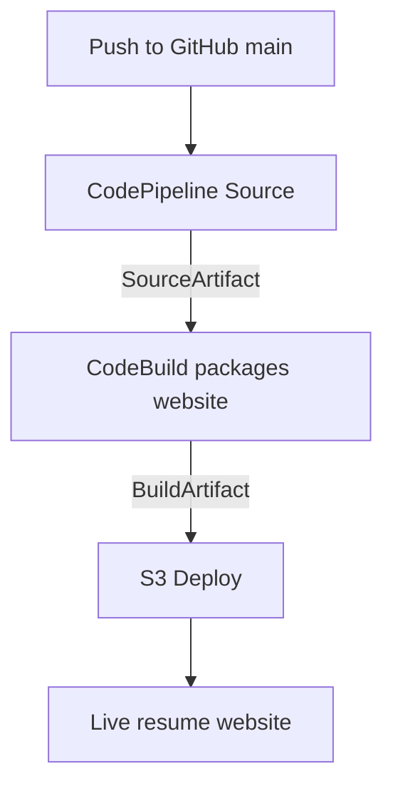

# Calvin Nguyen Resume Website

COMP 4964 individual assignment: a resume website automatically deployed from GitHub to Amazon S3 using AWS CodePipeline and CodeBuild.

[Live website](http://calvin-resume-4964.s3-website-us-west-2.amazonaws.com) · [GitHub repository](https://github.com/cnguyen50/COMP4964-Resume-Pipeline)

## Features

| Feature | Status |
| --- | --- |
| Responsive resume website and PDF | Complete |
| GitHub repository and `.gitignore` | Complete |
| Source, Build, and Deploy stages | Complete |
| Automatic deployment after a push to `main` | Verified |
| Automated testing | Optional, skipped |
| Monitoring, logging, and alarms | Optional, skipped |

The website uses HTTP. Chrome may warn when downloading the PDF. CloudFront and website HTTPS are not configured.

## Pipeline architecture



CodeBuild reads `buildspec.yml` and runs `scripts/build.py`. The script copies `site/` into a clean `dist/` folder. The deployment action extracts that build output into the S3 website bucket.

## Project files

| Path | Purpose |
| --- | --- |
| `site/index.html` | Resume content |
| `site/styles.css` | Website styling |
| `site/assets/Calvin-Nguyen-Resume.pdf` | Resume PDF |
| `scripts/build.py` | Creates the `dist/` deployment folder |
| `buildspec.yml` | CodeBuild commands and output configuration |
| `.gitignore` | Excludes generated files and local settings |

Only the contents of `site/` are deployed. Any starter tests remaining in the repository are not run by the pipeline.

## Setup

Use **US West Oregon (`us-west-2`)** for all AWS resources.

### 1. GitHub

Commit the project to `cnguyen50/COMP4964-Resume-Pipeline` on branch `main`. Keep `buildspec.yml` and `README.md` at the repository root. The generated `dist/` folder is ignored by Git.

### 2. S3 website

Create `calvin-resume-4964` with ACLs disabled, versioning disabled, and SSE-S3 encryption. To reproduce this setup, choose a different globally unique bucket name.

1. Enable **Static website hosting** and set the index document to `index.html`.
2. Keep the two ACL-related Block Public Access settings enabled. Disable the two public-policy blocking settings for this bucket.
3. Add a public read bucket policy:

```json
{
  "Version": "2012-10-17",
  "Statement": [{
    "Effect": "Allow",
    "Principal": "*",
    "Action": "s3:GetObject",
    "Resource": "arn:aws:s3:::calvin-resume-4964/*"
  }]
}
```

Use the website endpoint from **Properties → Static website hosting**. Keep CodePipeline's separate artifact bucket private.

### 3. GitHub connection

Create the connection `calvin-resume-github`. Install **AWS Connector for GitHub** on the `cnguyen50` account and grant it access to this repository. Complete the connection setup before selecting it in the pipeline.

### 4. CodePipeline

Create `calvin-resume-pipeline` with type **V2**, **Superseded** execution mode, a new service role, and the default artifact store and encryption settings.

| Stage | Configuration |
| --- | --- |
| Source | GitHub via GitHub App, connection `calvin-resume-github`, repository `cnguyen50/COMP4964-Resume-Pipeline`, branch `main`, default ZIP output |
| Build | CodeBuild project `calvin-resume-build`, input `SourceArtifact`, output `BuildArtifact` |
| Deploy | Amazon S3, bucket `calvin-resume-4964`, input `BuildArtifact`, blank deployment path, **Extract file before deploy** enabled |

Configure **Git Triggers → Push → Include branches: `main`** in the pipeline editor. Skip the optional Test stage.

For CodeBuild, create the project using on-demand EC2 compute, a managed Ubuntu standard container image such as `aws/codebuild/standard:7.0`, and a new service role. Keep privileged mode off and select **Use a buildspec file**. Finish with **Continue to CodePipeline**.

The buildspec is:

```yaml
version: 0.2

phases:
  build:
    commands:
      - python3 scripts/build.py

artifacts:
  base-directory: dist
  files:
    - '**/*'
```

### 5. Permissions

The pipeline role needs access to its artifact bucket, CodeBuild, the GitHub connection, and the website bucket. CodeBuild needs access to the input and output artifacts.

On `AWSCodePipelineServiceRole-us-west-2-calvin-resume-pipeline`, the inline policy `UseResumeGitHubConnection` grants both `codeconnections:UseConnection` and `codestar-connections:UseConnection` for the exact ARN of the new connection. Update this permission whenever the connection changes.

## Maintenance and troubleshooting

Update website files under `site/` and replace the PDF at its existing path. Keep credentials out of Git. To roll back content, use `git revert` and push the revert. Remove obsolete S3 objects separately when deleting or renaming assets, because the S3 deployment action does not delete them.

| Problem | Fix |
| --- | --- |
| CodeBuild project not found | Finish creating `calvin-resume-build` in Oregon and select it in the Build action |
| Push does not trigger deployment | Check the installed GitHub app, repository access, connection, and Push filter for `main` |
| Source cannot use the connection | Grant the pipeline role both UseConnection permissions for the current connection ARN |
| Build fails | Check CodeBuild Phase details, Python availability, and the root buildspec and script paths |
| Website returns AccessDenied | Check the website endpoint, public read policy, and bucket/account public-access settings |
| Page or CSS missing | Deploy `BuildArtifact` with extraction enabled and no deployment prefix |
| Old content appears | Confirm the new commit deployed successfully, then hard refresh |
| PDF download warning | Known HTTP hosting limitation; HTTPS hosting can address it in a future update |

During setup, creating the missing build project, installing the GitHub connector, and granting access to the new connection resolved the deployment issues. A commit-triggered execution and live page update were verified afterward.

## References

- [CodePipeline GitHub connections and permissions](https://docs.aws.amazon.com/codepipeline/latest/userguide/action-reference-CodestarConnectionSource.html)
- [CodeBuild buildspec reference](https://docs.aws.amazon.com/codebuild/latest/userguide/build-spec-ref.html)
- [S3 static website setup](https://docs.aws.amazon.com/AmazonS3/latest/userguide/HostingWebsiteOnS3Setup.html)